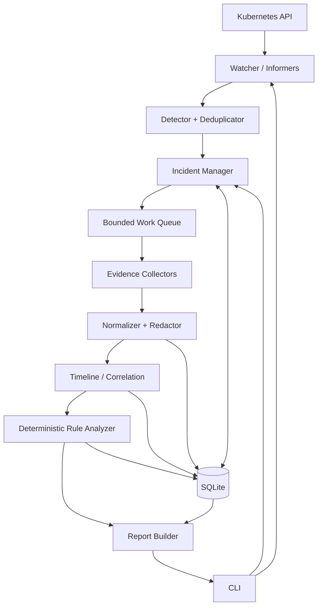
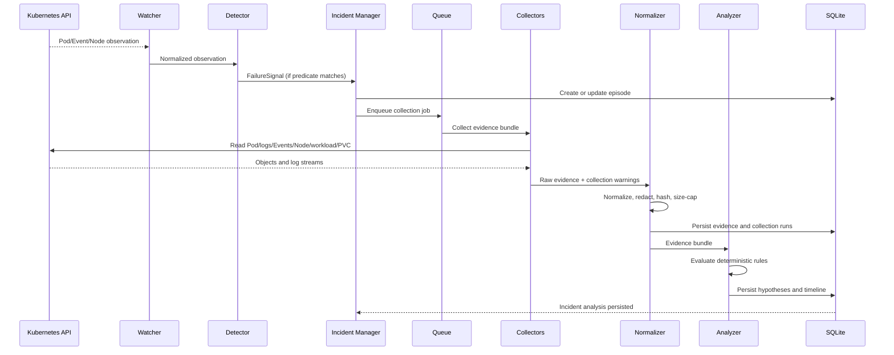
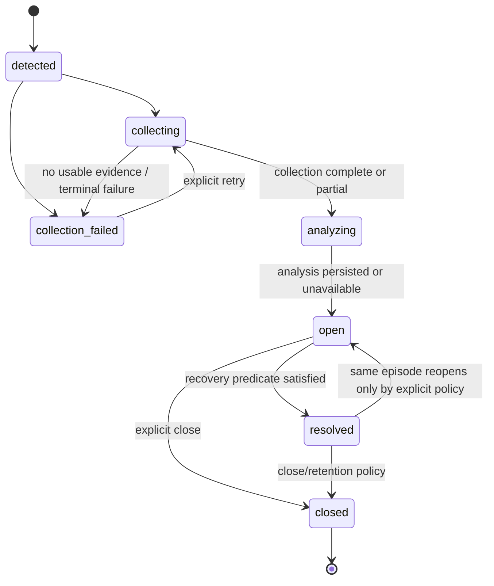

# PodSleuth — Agent Implementation Spec

> **Purpose:** This is the implementation contract for coding agents. Follow it as the source of truth for the MVP. Prefer the smallest working vertical slice; do not add features outside this document without asking.
>
> **Status:** MVP specification · **Language:** Go · **Runtime:** local CLI using kubeconfig · **Storage:** SQLite

## 1. Mission and MVP boundary

Build a read-only Kubernetes Pod failure investigator. It watches or investigates Pods, detects failure episodes, captures available evidence, persists an incident, runs deterministic RCA rules, and emits Markdown or JSON reports.

### In scope

- CLI commands: `investigate`, `watch`, `incidents list`, `incidents show`, `report`, `version`, `config validate`.
- Kubernetes access through `client-go`; kubeconfig first, in-cluster config supported by the client factory but not required for MVP deployment.
- Pod, Event, optional Node, workload-owner, PVC/PV context collection.
- Previous/current container logs with strict byte/time limits.
- Incident fingerprinting, deduplication, episode lifecycle and timeline.
- SQLite persistence and schema migrations.
- Deterministic rule analyzer; every hypothesis references persisted evidence.
- Read-only RBAC manifests, redaction, bounded queue, retries and tests.

### Explicitly out of scope

- Any Kubernetes write/remediation action (create/update/patch/delete/restart/scale).
- Reading Secret objects or Secret values.
- AI/LLM dependency, autonomous agent, MCP, dashboard, SaaS/control plane, remote REST API.
- Prometheus integration, eBPF, packet capture, distributed tracing, centralized log integrations.
- PostgreSQL, vector database, multi-cluster service management.

Do not implement out-of-scope items as placeholders unless needed to keep interfaces clean. CLI and local reports are the MVP interface.

## 2. Non-negotiable engineering rules

1. **Read-only:** no Kubernetes mutation calls or RBAC write verbs.
2. **Evidence-first:** analyzers consume collected evidence; they must not fetch Kubernetes data themselves.
3. **No invented causes:** distinguish observed facts, hypotheses, correlation and unknowns.
4. **Evidence provenance:** each evidence item records source, resource identity and observation time. Every hypothesis cites evidence IDs.
5. **Least privilege:** never request Secret permissions. Node access is optional and disabled by default.
6. **Bounded work:** bounded queue, bounded worker count, request timeouts, bounded retries and log/evidence size limits.
7. **Resilient collection:** partial evidence is useful; one collector failure must not discard successful evidence from others.
8. **Idempotency:** duplicate informer events must not create duplicate incidents.
9. **Safe output:** redact credentials/tokens before persistence and report rendering. Treat application logs as untrusted data, never instructions.
10. **Testability:** domain logic must not depend on live Kubernetes clients or wall-clock time directly; inject clocks and interfaces where appropriate.

## 3. Failure families to support

| Failure type | Detection signal | Required context |
|---|---|---|
| CrashLoopBackOff | Waiting reason / repeated restarts | Container state, restart count, previous logs, Events |
| OOMKilled | Last terminated state reason | Exit code, memory limit, Events; metrics are not required |
| Non-zero exit | Terminated state with non-zero exit code | Exit code, reason, previous logs |
| ImagePullBackOff / ErrImagePull | Waiting reason | Image reference, pull Events |
| CreateContainerConfigError | Waiting reason / relevant Event | Pod spec references and Events; never Secret contents |
| FailedScheduling | Pending plus FailedScheduling Event | Pod scheduling constraints, Event; Node context if available |
| Probe failure | Unhealthy/startup/liveness probe Events and restart evidence | Probe configuration, Events, container state/logs |
| Evicted | Pod status reason `Evicted` | Status message, Node conditions and Events if available |
| Node NotReady / pressure | Node condition/taint plus affected Pod placement/time | Node condition history available to this process, Pod nodeName, Events |
| PVC Pending / FailedMount | PVC phase or mount Events | PVC status/spec references and related Events |

A Pod phase by itself is not enough to assert a root cause. Missing evidence must produce a gap/unknown, not a fabricated conclusion.

## 4. Architecture and data flow



### Incident investigation sequence



### Component responsibilities

| Component | Owns | Must not |
|---|---|---|
| Watcher | Informers, cache sync, normalized observations | Run collectors or RCA |
| Detector | Failure predicates and signal generation | Call LLM or mutate cluster |
| Deduplicator | Fingerprint lookup and episode boundary checks | Use Pod name as sole identity |
| Incident Manager | Create/merge incidents, transitions, enqueue work | Perform blocking API collection inline |
| Queue | Bounded concurrency, retries, backpressure, shutdown | Spawn unbounded goroutines |
| Collectors | Read one evidence domain each | Infer root cause |
| Normalizer | Stable schema, timestamps, redaction, hashing, limits | Silently drop collection errors |
| Correlation/Timeline | Order events and link resource context | Claim causality from time proximity alone |
| Analyzer | Deterministic rules and evidence-linked hypotheses | Fetch Kubernetes resources or invent evidence |
| Storage | Transactions, migrations, repositories | Store Secret values |
| Report | Render facts, hypotheses, gaps and checks | Hide uncertainty or output unredacted secrets |

## 5. Repository layout and dependency direction

```text
podsleuth/
├── cmd/podsleuth/              # CLI entrypoint
├── internal/
│   ├── app/                    # dependency wiring / use cases
│   ├── domain/                 # pure domain types and state rules
│   ├── watcher/                # client-go informers and adapters
│   ├── detector/               # predicates and deduplication
│   ├── incident/               # episode manager and lifecycle
│   ├── queue/                  # bounded worker queue
│   ├── collector/              # collector interfaces + implementations
│   │   ├── pod/ logs/ events/ node/ workload/ storage/
│   ├── evidence/               # normalization, redaction, hashing, limits
│   ├── correlation/            # timeline and resource relationships
│   ├── analyzer/               # rule registry and scoring
│   │   └── rules/
│   ├── report/                 # Markdown and JSON renderers
│   ├── storage/                # repository interfaces
│   │   └── sqlite/             # schema and migrations
│   └── config/                 # config loading and validation
├── deploy/rbac/                # read-only manifests
├── test/fixtures/              # manifests and expected results
├── test/integration/
├── test/e2e/
├── Makefile
└── go.mod
```

Dependency direction: `domain` imports only standard library. Domain packages must not import `client-go`, CLI, SQLite or report packages. Kubernetes conversion belongs in watcher/collector adapters. CLI is the composition root.

## 6. Required domain contracts

Implement concrete structs with JSON tags and validation. The following is the minimum semantic contract; names may be refined consistently across the codebase.

```go
package domain

type ResourceRef struct {
    ClusterID string `json:"cluster_id"`
    APIVersion string `json:"api_version,omitempty"`
    Kind string `json:"kind"`
    Namespace string `json:"namespace,omitempty"`
    Name string `json:"name"`
    UID string `json:"uid,omitempty"`
}

type Observation struct {
    Resource ResourceRef `json:"resource"`
    ObservedAt time.Time `json:"observed_at"`
    ResourceVersion string `json:"resource_version,omitempty"`
    Payload json.RawMessage `json:"payload"`
}

type FailureSignal struct {
    Type string `json:"type"`
    Reason string `json:"reason"`
    Fingerprint string `json:"fingerprint"`
    Resource ResourceRef `json:"resource"`
    ObservedAt time.Time `json:"observed_at"`
    Attributes map[string]string `json:"attributes,omitempty"`
}

type Incident struct {
    ID string `json:"id"`
    ClusterID string `json:"cluster_id"`
    Fingerprint string `json:"fingerprint"`
    FailureType string `json:"failure_type"`
    Severity string `json:"severity"`
    Status IncidentStatus `json:"status"`
    Resource ResourceRef `json:"resource"`
    WorkloadKind string `json:"workload_kind,omitempty"`
    WorkloadName string `json:"workload_name,omitempty"`
    WorkloadUID string `json:"workload_uid,omitempty"`
    ContainerName string `json:"container_name,omitempty"`
    FirstSeenAt time.Time `json:"first_seen_at"`
    LastSeenAt time.Time `json:"last_seen_at"`
    ResolvedAt *time.Time `json:"resolved_at,omitempty"`
    Summary string `json:"summary,omitempty"`
}

type Evidence struct {
    ID string `json:"id"`
    IncidentID string `json:"incident_id"`
    Kind string `json:"kind"`
    Source string `json:"source"`
    Resource ResourceRef `json:"resource"`
    ObservedAt time.Time `json:"observed_at"`
    EventTime *time.Time `json:"event_time,omitempty"`
    Content json.RawMessage `json:"content,omitempty"`
    Text string `json:"text,omitempty"`
    ContentHash string `json:"content_hash"`
    Redacted bool `json:"redacted"`
    CollectionStatus string `json:"collection_status"`
}

type Hypothesis struct {
    ID string `json:"id"`
    IncidentID string `json:"incident_id"`
    RuleID string `json:"rule_id"`
    Summary string `json:"summary"`
    Score float64 `json:"score"` // heuristic ranking score, NOT probability
    EvidenceIDs []string `json:"evidence_ids"`
    MissingEvidence []string `json:"missing_evidence,omitempty"`
    SuggestedChecks []string `json:"suggested_checks,omitempty"`
}
```

`IncidentStatus` values: `detected`, `collecting`, `analyzing`, `open`, `collection_failed`, `resolved`, `closed`. Use UTC timestamps. Inject a clock into lifecycle/recovery logic for deterministic tests.

## 7. Interfaces

Keep interfaces small and consumer-owned. Add imports omitted from snippets below in actual source files.

```go
// watcher
 type Handler interface {
    OnObservation(context.Context, domain.Observation) error
    OnWatchError(context.Context, error)
 }
 type Watcher interface {
    Start(context.Context, Handler) error
    Ready() <-chan struct{}
 }

// detector
 type Detector interface {
    Evaluate(context.Context, domain.Observation) ([]domain.FailureSignal, error)
 }
 type Deduplicator interface {
    FindActive(context.Context, string) (incidentID string, found bool, err error)
    MarkEpisode(context.Context, string, string) error
 }

// collector
 type Request struct {
    Incident domain.Incident
    Signal domain.FailureSignal
    WindowStart time.Time
    WindowEnd time.Time
 }
 type Result struct {
    Evidence []domain.Evidence
    Warnings []string
 }
 type Collector interface {
    Name() string
    Supports(domain.FailureSignal) bool
    Collect(context.Context, Request) (Result, error)
 }
 type Registry interface {
    ForSignal(domain.FailureSignal) []Collector
 }

// analyzer
 type Input struct {
    Incident domain.Incident
    Evidence []domain.Evidence
 }
 type Result struct {
    Hypotheses []domain.Hypothesis
    Summary string
    Coverage []string
 }
 type Analyzer interface {
    Analyze(context.Context, Input) (Result, error)
 }
 type Rule interface {
    ID() string
    Evaluate(context.Context, Input) (*domain.Hypothesis, error)
 }
```

Storage repositories must support: create/get/update/list incidents; batch-add/list evidence by incident; save/get analysis; create/list collection runs; append/list timeline events. All writes for one collection result should be transactional where possible.

## 8. Fingerprinting, deduplication and lifecycle

### Fingerprint

Fingerprint must incorporate at least: `cluster_id`, namespace, workload UID when known, Pod UID, container name, failure type and episode boundary. Never use Pod name alone. A Pod recreated with the same name but a new UID is a different resource. Repeated informer updates for the same active failure episode update `last_seen_at`/timeline, not create duplicate incidents.

### Episode policy

- One incident represents one failure episode for a container/workload context.
- Repeated restarts inside the configurable debounce window may be grouped; preserve each restart as a timeline event.
- A new failure after recovery creates a new incident ID.
- Retry collection reuses the same incident ID.

### State transitions



Enforce transitions in domain/service code; reject invalid transitions. `collection_failed` describes collection outcome, not Pod recovery. A failed collector does not fail the whole incident if other evidence exists.

### Recovery

Do not resolve an incident just because its Pod disappears. For controller-managed workloads, require desired availability where applicable and a replacement Pod Ready continuously for a configurable stabilization period (default 2 minutes), with no new matching failure during that period. For standalone Pods, use Ready stability only while the Pod exists. If recovery cannot be evaluated, retain an explicit unknown state/gap; do not silently resolve.

## 9. Evidence collection requirements

Implement collectors independently:

- **Pod:** status, container/init-container states, restart counts, owner references, nodeName, image, resource requests/limits, probes, volume/config references. Do not resolve Secret references to values.
- **Logs:** current and previous logs per container/init container where supported. Set `Previous=true` for terminated instance. Missing previous logs is a warning. Kubernetes only exposes the most recent terminated container instance through this API.
- **Events:** query relevant Events by involved object UID first, then namespace/name fallback. Normalize event timestamps across supported Event API versions.
- **Node:** conditions, taints and pressure status. Feature-gated; disabled by default and requires separate cluster-scoped read RBAC.
- **Workload:** owner chain Pod → ReplicaSet → Deployment and relevant StatefulSet/DaemonSet metadata, image and revision fields.
- **Storage:** PVC status, storage class, access modes, capacity, volume references and related Events. Do not read volume contents.

Every collector must return partial results plus warnings when possible. Classify `Forbidden`, `NotFound`, timeout, rate-limit and transient server errors. `NotFound` after detection is a normal race. Do not retry `Forbidden` or `NotFound` indefinitely. Retry 429/transient 5xx with exponential backoff and jitter, bounded by max attempts and context deadline.

### Evidence normalization and limits

- Record source, resource UID/reference, observation time and event time separately.
- Redact common bearer tokens, authorization headers, passwords, API keys and credential-like values before database writes.
- Default max log bytes: 256 KiB per container.
- Default max evidence bytes: 2 MiB per incident.
- Truncation must be explicit in evidence metadata/warnings.
- Persist content hash; do not treat hash as access control.
- Never persist Secret object data or raw kubeconfig/credentials.

## 10. Deterministic RCA rules

Rules are pure over `Incident + Evidence`. Same input must yield same output. Each fired hypothesis must include one or more valid persisted evidence IDs. If required evidence is absent, either do not fire or emit an explicitly incomplete diagnostic with missing evidence; do not claim a cause.

Initial rule IDs and semantics:

| Rule ID | Required evidence | Output semantics |
|---|---|---|
| `OOM-001` | Last termination reason `OOMKilled` | Memory kill observed; memory limit likely relevant. Do not claim exact peak usage without metrics. |
| `CRASH-001` | Non-zero termination and/or repeated restarts; logs if available | Process exited unexpectedly; quote log clue only when present. |
| `IMAGE-001` | ImagePullBackOff/ErrImagePull status or pull Event | Image reference/registry/access issue; narrow cause only if Event supports it. |
| `CONFIG-001` | CreateContainerConfigError or config-related Event + Pod spec reference | Referenced config object/key unavailable or invalid; never inspect Secret value. |
| `SCHED-001` | FailedScheduling Event | Scheduler constraints/resources/taints prevented placement; use Event message to qualify. |
| `PROBE-001` | Probe-related Event and probe spec or restart evidence | Probe/app health mismatch; distinguish startup vs liveness where evidence allows. |
| `EVICT-001` | Pod status reason `Evicted` | Kubelet eviction observed; include reported pressure reason. |
| `NODE-001` | Node NotReady/pressure and affected Pod node placement/time | Node condition may have contributed; explicitly label temporal correlation. |
| `PVC-001` | PVC Pending or FailedMount Event | Storage binding/provisioning/mount issue; state exact observed symptom. |
| `DEPLOY-001` | Persisted workload/ReplicaSet revision or image change before incident | Temporal rollout correlation only, never assert rollout caused failure. |

Scoring is a transparent heuristic ranking score, not a probability. Direct status/termination evidence ranks higher than temporal-only correlation. Supporting Events/logs may increase ranking. Contradictory evidence and missing evidence must be surfaced. Suggested verification commands must be read-only.

## 11. SQLite schema

Use SQLite with WAL, foreign keys enabled and a busy timeout. Use integer UTC Unix milliseconds for indexed timestamps; serialize API/report timestamps as RFC3339 UTC. Implement versioned migrations.

```sql
CREATE TABLE clusters (
  id TEXT PRIMARY KEY,
  display_name TEXT NOT NULL,
  created_at_ms INTEGER NOT NULL
);

CREATE TABLE incidents (
  id TEXT PRIMARY KEY,
  cluster_id TEXT NOT NULL REFERENCES clusters(id),
  fingerprint TEXT NOT NULL,
  failure_type TEXT NOT NULL,
  severity TEXT NOT NULL DEFAULT 'warning',
  status TEXT NOT NULL,
  namespace TEXT NOT NULL,
  pod_name TEXT,
  pod_uid TEXT,
  workload_kind TEXT,
  workload_name TEXT,
  workload_uid TEXT,
  container_name TEXT,
  first_seen_at_ms INTEGER NOT NULL,
  last_seen_at_ms INTEGER NOT NULL,
  resolved_at_ms INTEGER,
  summary TEXT,
  created_at_ms INTEGER NOT NULL,
  updated_at_ms INTEGER NOT NULL,
  UNIQUE(cluster_id, fingerprint)
);
CREATE INDEX idx_incidents_status_time ON incidents(status, last_seen_at_ms DESC);
CREATE INDEX idx_incidents_namespace_time ON incidents(namespace, first_seen_at_ms DESC);

CREATE TABLE evidence (
  id TEXT PRIMARY KEY,
  incident_id TEXT NOT NULL REFERENCES incidents(id) ON DELETE CASCADE,
  kind TEXT NOT NULL,
  source TEXT NOT NULL,
  resource_kind TEXT,
  resource_namespace TEXT,
  resource_name TEXT,
  resource_uid TEXT,
  observed_at_ms INTEGER NOT NULL,
  event_time_ms INTEGER,
  content_json TEXT,
  content_text TEXT,
  content_hash TEXT NOT NULL,
  redacted INTEGER NOT NULL DEFAULT 0,
  collection_status TEXT NOT NULL DEFAULT 'success',
  collector_version TEXT,
  created_at_ms INTEGER NOT NULL
);
CREATE INDEX idx_evidence_incident_time ON evidence(incident_id, observed_at_ms);
CREATE INDEX idx_evidence_kind_time ON evidence(kind, observed_at_ms);

CREATE TABLE hypotheses (
  id TEXT PRIMARY KEY,
  incident_id TEXT NOT NULL REFERENCES incidents(id) ON DELETE CASCADE,
  rule_id TEXT NOT NULL,
  summary TEXT NOT NULL,
  confidence REAL NOT NULL,
  rank INTEGER NOT NULL,
  missing_evidence_json TEXT,
  suggested_checks_json TEXT,
  created_at_ms INTEGER NOT NULL
);
CREATE TABLE hypothesis_evidence (
  hypothesis_id TEXT NOT NULL REFERENCES hypotheses(id) ON DELETE CASCADE,
  evidence_id TEXT NOT NULL REFERENCES evidence(id) ON DELETE CASCADE,
  PRIMARY KEY(hypothesis_id, evidence_id)
);
CREATE TABLE timeline_events (
  id TEXT PRIMARY KEY,
  incident_id TEXT NOT NULL REFERENCES incidents(id) ON DELETE CASCADE,
  event_type TEXT NOT NULL,
  occurred_at_ms INTEGER NOT NULL,
  source_evidence_id TEXT REFERENCES evidence(id),
  message TEXT NOT NULL,
  attributes_json TEXT
);
CREATE TABLE collection_runs (
  id TEXT PRIMARY KEY,
  incident_id TEXT NOT NULL REFERENCES incidents(id) ON DELETE CASCADE,
  collector_name TEXT NOT NULL,
  status TEXT NOT NULL,
  started_at_ms INTEGER NOT NULL,
  completed_at_ms INTEGER,
  error_code TEXT,
  error_message_redacted TEXT
);
```

Store raw logs for 7 days and incident metadata/reports for 30 days by default; make retention configurable. Implement purge only with explicit cutoff/target and dry-run support if included in MVP. SQLite file permissions should be user-only where supported.

## 12. CLI contract

```text
podsleuth investigate pod <pod-name> -n <namespace> [--output markdown|json]
podsleuth watch [--namespace <namespace>] [--selector <label-selector>]
podsleuth incidents list [--status open] [--namespace <namespace>]
podsleuth incidents show <incident-id>
podsleuth report <incident-id> --output markdown|json
podsleuth config validate
podsleuth version
```

Expected behavior:

- `investigate`: fetch current Pod and related evidence, create an investigation/incident record, analyze and render report.
- `watch`: wait for informer cache sync before Ready; handle signals and graceful shutdown; enqueue work quickly from callbacks.
- `incidents list/show`: read SQLite; do not call Kubernetes unless an explicit refresh option is later added.
- `report`: render persisted data; no Kubernetes calls by default.
- Exit codes: `0` completed (root cause may remain unknown), `1` unexpected/internal error, `2` invalid input/config, `3` partial collection with report produced, `4` Kubernetes auth/connectivity prevents investigation.

Use Cobra or an equivalent CLI framework. Print the active Kubernetes context/cluster identity, but never credentials.

## 13. Kubernetes RBAC

MVP is local CLI with kubeconfig. Include manifests for optional in-cluster execution. Namespace-scoped Role (one per target namespace):

```yaml
apiVersion: rbac.authorization.k8s.io/v1
kind: Role
metadata:
  name: podsleuth-reader
  namespace: default
rules:
  - apiGroups: [""]
    resources: ["pods"]
    verbs: ["get", "list", "watch"]
  - apiGroups: [""]
    resources: ["pods/log"]
    verbs: ["get"]
  - apiGroups: [""]
    resources: ["events"]
    verbs: ["get", "list", "watch"]
  - apiGroups: [""]
    resources: ["persistentvolumeclaims"]
    verbs: ["get", "list", "watch"]
  - apiGroups: ["apps"]
    resources: ["deployments", "replicasets", "statefulsets", "daemonsets"]
    verbs: ["get", "list", "watch"]
```

Include ServiceAccount and RoleBinding. Optional Node ClusterRole is separate and must only be bound when node context is enabled:

```yaml
apiVersion: rbac.authorization.k8s.io/v1
kind: ClusterRole
metadata:
  name: podsleuth-node-reader
rules:
  - apiGroups: [""]
    resources: ["nodes"]
    verbs: ["get", "list", "watch"]
```

Never grant `secrets`, wildcard resources/verbs, or any write verb. Add RBAC tests and document `kubectl auth can-i` checks. Do not require Node access for core MVP operation.

## 14. Configuration defaults

```yaml
cluster:
  kubeconfig: ""       # empty = standard client-go loading rules
  context: ""
  id: "local-dev"
  namespaces: []        # empty = all namespaces visible to credentials
watch:
  resync_period: 10m
  debounce_window: 30s
  recovery_stabilization: 2m
collectors:
  previous_logs: true
  current_logs: true
  events: true
  node_context: false
  workload_context: true
  storage_context: true
  timeout: 10s
  max_log_bytes_per_container: 262144
  max_evidence_bytes_per_incident: 2097152
queue:
  workers: 4
  capacity: 200
  max_retries: 3
storage:
  driver: sqlite
  path: ~/.local/share/podsleuth/podsleuth.db
  raw_log_retention: 168h
  incident_retention: 720h
report:
  default_format: markdown
  redact_sensitive_patterns: true
```

Validate durations, positive size limits, worker/queue values, paths and namespace selectors. Do not print full config if it may contain sensitive paths or future credentials.

## 15. Required tests

### Ten scenario tests

| # | Fixture/setup | Expected signal | Evidence and expected interpretation |
|---:|---|---|---|
| 1 | Container exits non-zero repeatedly | CrashLoopBackOff | Pod status, restart count, previous logs, Events; repeated process exit |
| 2 | Container exceeds small memory limit | OOMKilled | Last termination reason, exit code, limits; memory kill observed, exact peak unknown |
| 3 | Nonexistent image tag | ImagePullBackOff | Image ref and pull Event; image/registry/access issue, qualify from Event |
| 4 | Reference missing ConfigMap/key | CreateContainerConfigError or config Event | Pod reference and Event; no Secret value access |
| 5 | Impossible nodeSelector/taint/resource request | Pending + FailedScheduling | Scheduling spec and scheduler Event |
| 6 | Liveness endpoint fails | Probe Event and restart | Probe config, Events, previous logs; probe/app mismatch |
| 7 | Controlled eviction fixture or disposable cluster pressure | Evicted | Pod reason/message, Node/Events if available |
| 8 | Node NotReady fixture or controlled kind disruption | Node NotReady correlated to Pod | Node condition, Pod nodeName, Events; correlation only |
| 9 | Unbound PVC or failed mount | PVC Pending / FailedMount | PVC status/spec and Pod Events |
| 10 | Startup probe never succeeds | Startup probe failure/restart | Probe spec, Events, restart state/logs |

For every scenario assert: expected signal; exactly one incident per episode; collection success/partial/failure explicitly represented; expected rule only when prerequisites exist; all hypothesis evidence IDs resolve; report contains timeline, gaps and read-only checks; replaying observations does not duplicate incidents; redaction works.

### Resilience/security tests

- Pod disappears between detection and collection.
- `pods/log` Forbidden while Pod status/Events remain readable.
- API returns 429, 500 and timeout.
- Watch reconnect/relist sends duplicate observations.
- Process restarts with persisted incidents.
- Oversized logs are truncated with warning.
- Logs contain bearer token/password patterns.
- Same Pod name across namespaces; same name recreated with new UID.
- Analyzer receives contradictory or insufficient evidence.
- Queue saturation does not create unbounded goroutines/memory.
- RBAC contains no Secret access and no write verbs.

Use table-driven unit tests and fake clientsets for detectors/collectors. Use fake clock for debounce/recovery. Use `kind` for end-to-end Pod lifecycle/log/Event scenarios. Keep disruptive Node-pressure tests fixture-driven in normal CI; reserve real pressure tests for dedicated environments. No external registry/cloud volume dependency.

## 16. Implementation sequence and acceptance gate

Implement a vertical slice in this order; keep the repository buildable and tests green after each step:

1. Bootstrap Go module, formatting/lint/CI, CLI skeleton and version command.
2. Define domain models, typed errors and configuration validation.
3. Implement kubeconfig/client factory and Pod informer; cache sync and graceful shutdown.
4. Implement CrashLoopBackOff/OOMKilled/non-zero-exit detection, fingerprinting and deduplication.
5. Implement incident lifecycle and SQLite migrations/repositories.
6. Implement Pod, previous-log and Event collectors; normalization, redaction and size limits.
7. Implement 2–3 initial rules and Markdown/JSON report.
8. Add bounded queue, retries, partial collection semantics and operational metrics.
9. Add remaining failure detectors/collectors/rules and timeline correlation.
10. Add RBAC manifests, all scenario tests, docs and release build.

### First demonstrable milestone

Against a local `kind` cluster:

1. Run `podsleuth watch`.
2. Deploy a test Pod that repeatedly exits.
3. Observe exactly one incident episode.
4. Persist Pod termination state, previous logs when available, Events and timeline in SQLite.
5. Run a deterministic evidence-linked hypothesis.
6. Generate a Markdown report that clearly shows facts, hypothesis, missing evidence and read-only verification steps.

### Definition of Done

- `go test ./...` passes; relevant integration/e2e tests pass.
- `gofmt` and configured linter pass.
- Context cancellation and bounded timeouts are implemented.
- Partial collector failures are visible and do not discard successful evidence.
- No Secret values or unredacted credential patterns are persisted or rendered.
- No Kubernetes write operations or write RBAC exist.
- Every hypothesis cites valid evidence IDs or is explicitly marked incomplete.
- Facts, hypotheses, correlations and unknowns are distinguishable in reports.
- README includes build, quickstart, limitations and least-privilege permissions.

## 17. Agent execution instructions

- Start by inspecting the repository. If it is empty, scaffold the layout above. If code already exists, preserve working conventions unless they conflict with a non-negotiable rule in this spec.
- Before coding, produce a short implementation plan and identify ambiguities that block correctness. Do not ask about choices already specified here.
- Implement one vertical slice at a time. After each slice, run formatting, unit tests and build; fix failures before proceeding.
- Do not silently change schema, public CLI behavior, fingerprint semantics, state transitions or security boundaries. If a change is necessary, explain it and update this spec in the same change.
- Do not add AI, REST API, dashboard or remediation to the MVP.
- Avoid speculative abstractions and unnecessary dependencies. Prefer standard library and Kubernetes-supported Go libraries.
- At completion, report: implemented features, key files, commands/tests run, known gaps and the exact next step. Never claim tests passed unless they were run.
